# De Web a Physical AI: agentes físicos con Gemini Live y JavaScript

[](https://jsconfmx26.web.app)
[](https://jsconfmx26.web.app/slides)
[](https://jsconfmx26.web.app/demo)
[](https://ai.google.dev/gemini-api/docs/models/gemini-3.8-live)



Repositorio de la charla **«De Web a Physical AI: agentes físicos con Gemini Live y JavaScript»** de **Adrián Catalán (`@adriancs.tech`)** en JSConf MX 2026. Muestra cómo un equipo web puede construir un agente de Physical AI con las herramientas que ya conoce:

- **Gemini Live (`gemini-3.8-live`)** por WebSocket desde el navegador, con herramientas que devuelven al modelo el resultado real de cada movimiento.
- **Gemelo digital en Three.js** armado con las 16 mallas `.stl` del fabricante.
- **Bridge en Rust (`robot-bridge`, puerto 9000)** con loop de control de 40 Hz, freno por LiDAR, paro de emergencia enclavado y token fuera de `localhost`.
- **Hiwonder ROSOrin Pro** con Jetson Orin Nano, ROS 2 Humble y un STM32 por UART a 1 Mbps.

## Pruébalo

Sin instalar nada: abre el [simulador 3D](https://jsconfmx26.web.app/demo) o las [slides](https://jsconfmx26.web.app/slides).

En tu laptop, sin robot (necesitas Node 22, Rust `>= 1.87` y una [API key de Gemini](https://aistudio.google.com/apikey) para las demos de voz; en Linux también `libudev-dev` y `pkg-config`):

```bash
git clone https://github.com/ykro/rosorin-jsconf.git
cd rosorin-jsconf
./run.sh --mock
```

Abre la URL que imprime `run.sh` (`http://localhost:3000/`). Para conectar tu laptop al robot físico sigue [`docs/ONBOARDING.md`](./docs/ONBOARDING.md).

## Documentación

| Documento | Qué encuentras |
|---|---|
| [`docs/ONBOARDING.md`](./docs/ONBOARDING.md) | Requisitos, modo simulador, laptop conectada al robot, token, banderas de `run.sh` y problemas comunes. |
| [`docs/COMMANDS.md`](./docs/COMMANDS.md) | Comandos de `make`, `iniciar-robot.sh` y scripts de la web. |
| [`docs/WEB.md`](./docs/WEB.md) | Sitio público, rutas de la web y gestos del simulador. |
| [`docs/DEMOS.md`](./docs/DEMOS.md) | Las 4 demos (Repo Roaster, Gatekeeper CI/CD, Bug Hunter y Bumblebee Radio), los MP3 y los props imprimibles. |
| [`docs/SECURITY.md`](./docs/SECURITY.md) | Token, orígenes, paro de emergencia, LiDAR que falla cerrado y operación en el robot. |
| [`docs/ARCHITECTURE.md`](./docs/ARCHITECTURE.md) | Capas, tiempos, por qué Rust y la pantalla `/face`. |
| [`docs/RUST_FOR_WEB_DEVS.md`](./docs/RUST_FOR_WEB_DEVS.md) | Cómo funciona `robot-bridge` explicado desde Node.js. |
| [`docs/API.md`](./docs/API.md) · [`docs/openapi.yaml`](./docs/openapi.yaml) | Contrato HTTP y WebSocket del bridge, errores y herramientas de Gemini. |
| [`docs/STRUCTURE.md`](./docs/STRUCTURE.md) | Mapa de carpetas y archivos. |
| [`skills/`](./skills/README.md) | Skills para agentes de código: `rosorin-pro`, `gemini-live-js` y `threejs-urdf-twin`. |
| [`AGENTS.md`](./AGENTS.md) · [`CONTRIBUTING.md`](./CONTRIBUTING.md) | Reglas y verificación para agentes y para quien contribuya. |
| [`robot-bridge/.env.example`](./robot-bridge/.env.example) · [`web/.env.example`](./web/.env.example) | Variables del bridge y de la web. |

## Licencia

El código es MIT ([`LICENSE`](./LICENSE)). Las mallas 3D son de Hiwonder y se incluyen con atribución; ver [`NOTICE`](./NOTICE).
