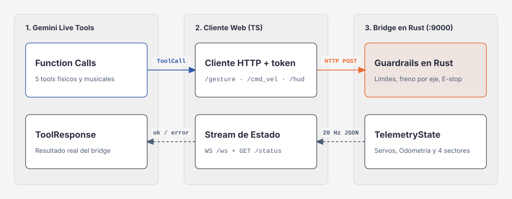

# La API del bridge y las herramientas de Gemini



El sistema tiene dos interfaces:

1. **La API HTTP y WebSocket del bridge** (`http://<HOST>:9000`), servida por el binario `rosorin-bridge` (`axum` + `tokio`, código en [`robot-bridge/src/main.rs`](../robot-bridge/src/main.rs)). Mueve el chasis Mecanum y el brazo (servos 1 a 5 y pinza 10), maneja LEDs, buzzer y el HUD de `/face`, y transmite la telemetría.
2. **Las herramientas de Gemini Live** (`EMBODIED_TOOLS` en [`web/src/lib/gemini-live.ts`](../web/src/lib/gemini-live.ts) y `BUMBLEBEE_TOOLS` en [`web/src/lib/bumblebee-radio.ts`](../web/src/lib/bumblebee-radio.ts)), que el navegador traduce a llamadas HTTP al bridge.

> [!NOTE]
> El contrato formal está en [`docs/openapi.yaml`](./openapi.yaml) (OpenAPI 3.1.0). Sirve para Postman, Bruno, Insomnia o un generador de clientes. El WebSocket `/ws` va descrito ahí en texto porque OpenAPI no lo modela.

---

## Parte I · Reglas comunes

### Dirección y token

- **URL base:** `http://localhost:9000` en la laptop o `http://<IP_DEL_ROBOT>:9000` en el robot.
- **Dirección de escucha:** `127.0.0.1` por defecto (`--host` / `BRIDGE_HOST`). Fuera de loopback el bridge exige `BRIDGE_TOKEN` y sin él sale con código `2`, salvo con `--insecure-no-token`.
- **Token:** si `BRIDGE_TOKEN` está definido, se pide en **todas** las rutas menos `GET /health` y los preflight `OPTIONS`. Se acepta en:
  - `x-bridge-token: <token>`
  - `Authorization: Bearer <token>`
  - `?token=<token>`, **solo en `GET /ws`** (los navegadores no pueden poner headers al abrir un WebSocket).

  La comparación es de tiempo constante. `GET /camera/frame` también pide token, así que no sirve un `` directo: pídelo con `fetch` y el header, y conviértelo en un *object URL*.

### Orden de los filtros

Cada petición pasa, de afuera hacia adentro, por: `Host` y `Origin` → CORS → límite de cuerpo (8 KiB) → token → límite de peticiones → handler.

- **`Host`** (protección contra *DNS rebinding*): debe ser una IP literal, `localhost` o un nombre de `BRIDGE_ALLOWED_HOSTS`. Si no, `403 forbidden_host`.
- **`Origin`** (si viene): IPs de loopback, `localhost`, `jsconfmx26.web.app`, `jsconfmx26.firebaseapp.com` o un origen exacto de `BRIDGE_ALLOWED_ORIGINS`. Las IPs privadas (`10/8`, `172.16/12`, `192.168/16`) solo se aceptan si el bridge tiene token o escucha fuera de loopback; un bridge en `127.0.0.1` sin token las rechaza, para que una página servida desde la LAN no pueda moverlo. Si no, `403 forbidden_origin`. Aplica a cualquier método, también a POST sin preflight y al WebSocket. El log de arranque dice `orígenes IP privadas=sí|no`.
- **CORS:** métodos `GET, POST, OPTIONS`; headers `content-type`, `authorization`, `accept`, `x-bridge-token`.
- **Límite de peticiones:** un balde global de 30 POST por segundo con ráfaga de 60. `POST /stop` y `POST /estop/release` no cuentan. Las operaciones de movimiento por WebSocket comparten el mismo balde (menos `stop`).

### Formato de errores

Los errores que genera el bridge son JSON:

```json
{ "status": "estop_latched", "message": "STOP activo (E-stop enclavada). POST /estop/release para liberar." }
```

| HTTP | `status` | Cuándo |
|---|---|---|
| `400` | `invalid_request` | `/arm` con 0 o más de 6 servos o con un ID fuera de `{1, 2, 3, 4, 5, 10}`; `/servo/jog` con ID inválido o `delta` fuera de `-300..300`. |
| `401` | `unauthorized` | Falta el token o no coincide. |
| `403` | `forbidden_host` | `Host` no permitido. |
| `403` | `forbidden_origin` | `Origin` no permitido. |
| `400` | `invalid_request` | `/simulate/scene` con más de 8 objetos, un `id` desconocido o `|x_m|`, `|y_m|` mayores que 1.5. |
| `403` | `forbidden` | `POST /simulate/lidar` o `GET`/`POST /simulate/scene` fuera del backend mock. |
| `404` | `not_found` | `POST /gesture` con un nombre desconocido. |
| `409` | `scan_running` | `POST /scan_env` con un reconocimiento en curso. |
| `423` | `estop_latched` | E-stop enclavada en una ruta de movimiento. |
| `429` | `rate_limited` | Se vació el balde de peticiones. |
| `503` | `worker_dead` | `POST /scan_env` con el driver sin responder (`connected: false`). |
| `503` | `no_camera` | `POST /scan_env` con el backend `serial`, que no tiene cámara. |

Otros errores los produce `axum` antes de llegar al handler y su cuerpo es **texto plano**, no JSON:

| HTTP | Cuándo | Cuerpo de ejemplo |
|---|---|---|
| `400` | JSON mal formado | `Failed to parse the request body as JSON: …` |
| `413` | Cuerpo de más de 8 KiB (8192 bytes) | `Failed to buffer the request body: length limit exceeded` |
| `415` | POST con cuerpo sin `Content-Type: application/json` | ``Expected request with `Content-Type: application/json` `` |
| `422` | JSON válido con tipos incorrectos (por ejemplo `"linear_x": "rápido"` o `"position": -5`) | `Failed to deserialize the JSON body into the target type: …` |
| `404` | Ruta inexistente | vacío |
| `405` | Método equivocado (por ejemplo `GET /stop`) | vacío |

### STOP / E-stop enclavada

`POST /stop` enclava la E-stop. Mientras está enclavada, estas rutas responden `423 estop_latched`: `/cmd_vel`, `/arm`, `/servo/jog`, `/arm/jog`, `/gesture`, `/scene/reset`, `/buzzer` y `POST /scan_env`. Siguen funcionando `/hud`, `/rgb`, `/simulate/lidar`, `/simulate/scene`, `/status`, `GET /scan_env`, `/camera/frame` y `/ws`. `/stop` también aborta un reconocimiento en curso (`scan_env.reason: "estop"`). Solo `POST /estop/release` la libera; el watchdog no la toca.

Al apagarse (SIGINT o SIGTERM), el bridge también enclava la E-stop y pone el chasis en 0 antes de salir, así que ninguna conexión que siga abierta puede mover el robot mientras el proceso termina.

### Campo `blocked`

Todas las respuestas de acción (`200`) traen `blocked`: el comando se aceptó, pero quizá el robot no se movió como pediste. Vale `null` si se ejecutó tal cual; si no, dice por qué. El código HTTP sigue siendo `200`: no es un error de la petición, es el resultado físico.

| Valor | Significa |
|---|---|
| `null` | Se ejecutó como pediste. |
| `worker_dead` | Nada llega al hardware: el worker de ROS 2 terminó o no contesta el *heartbeat*, o las escrituras al puerto serie o al stdin del worker fallan o llevan más de 300 ms atascadas. `connected` es `false`. |
| `lidar_stale` | Con `ros2`, no llega un scan desde hace más de 300 ms: el chasis queda en 0. |
| `braked` | El freno del LiDAR anuló al menos un eje o limitó `|angular_z|` a 0.3 rad/s. |

Qué valores puede traer cada ruta:

| Ruta | Valores posibles |
|---|---|
| `POST /cmd_vel` | `worker_dead` o `lidar_stale` (si pedías movimiento), `braked`. |
| `POST /gesture` | Lo que bloquearía el gesto en ese momento: `worker_dead`; `lidar_stale` o `braked` solo si el gesto mueve el chasis. El brazo del gesto sí se mueve con `braked`. |
| `POST /arm`, `/servo/jog`, `/arm/jog`, `/scene/reset`, `/stop`, `/rgb`, `/buzzer` | Solo `worker_dead`. |
| `POST /hud`, `/estop/release`, `/simulate/lidar`, `/simulate/scene`, `/scan_env` | Siempre `null` (`/scan_env` rechaza con `503` en vez de aceptar sin driver). |

Un comando que no se escribe al hardware (por ejemplo `/rgb` con el backend `serial`, que no tiene trama de LEDs) no cuenta para la salud del driver. Por WebSocket, el mismo resultado llega como evento `blocked` (ver Parte III).

---

## Parte II · Endpoints

### Tabla general

| Método | Ruta | Cuerpo | Respuesta `200` | 423 con E-stop | Cuenta para el límite |
|---|---|---|---|---|---|
| `GET` | `/health` | — | `{"status":"ok"}` (sin token) | No | No |
| `GET` | `/status` | — | `TelemetryState` | No | No |
| `GET` | `/camera/frame` | — | `image/jpeg` o `image/svg+xml` | No | No |
| `GET` | `/config/gemini-key` | — | `{"configured":true,"api_key":"…","source":"GEMINI_API_KEY"}` o `{"configured":false}` | No | No |
| `GET` | `/ws` | Upgrade a WebSocket | `101 Switching Protocols` | — | Ops de movimiento |
| `POST` | `/cmd_vel` | `CmdVelRequest` | `ActionResponse` | Sí | Sí |
| `POST` | `/arm` | `ArmRequest` | `ActionResponse` | Sí | Sí |
| `POST` | `/servo/jog` y `/arm/jog` | `ServoJogRequest` | `ActionResponse` | Sí | Sí |
| `POST` | `/gesture` | `GestureRequest` | `ActionResponse` | Sí | Sí |
| `POST` | `/scene/reset` | — | `ActionResponse` | Sí | Sí |
| `POST` | `/buzzer` | `BuzzerRequest` | `ActionResponse` | Sí | Sí |
| `POST` | `/hud` | `HudUpdateRequest` | `ActionResponse` | No | Sí |
| `POST` | `/rgb` | `RgbRequest` | `ActionResponse` | No | Sí |
| `POST` | `/simulate/lidar` | `LidarSimRequest` | `ActionResponse` (solo mock) | No | Sí |
| `POST` | `/scan_env` | `ScanEnvRequest` | `ActionResponse` (`409` si ya corre, `503` sin driver o cámara) | Sí | Sí |
| `GET` | `/scan_env` | — | `ScanEnvStatus` | No | No |
| `GET` | `/simulate/scene` | — | Lista de `SimObject` (solo mock) | No | No |
| `POST` | `/simulate/scene` | `SimSceneRequest` | `ActionResponse` (solo mock) | No | Sí |
| `POST` | `/stop` | — | `ActionResponse` | — | No |
| `POST` | `/estop/release` | — | `ActionResponse` | — | No |

Todos los `POST` responden `ActionResponse`: `{ "status": "ok", "action": "<resumen>", "blocked": null, "telemetry": { …TelemetryState } }`. Los valores de `blocked` están en [Campo `blocked`](#campo-blocked). Los gestos que apuntan a un objeto del escenario agregan `aim` (ver [`POST /gesture`](#post-gesture)).

### `GET /health`

Responde `{"status":"ok"}` sin pedir token. Sirve para saber si el bridge está vivo (lo usa `iniciar-robot.sh`).

### `GET /status`

Devuelve la telemetría actual. Ejemplo real del backend mock recién arrancado:

```json
{
  "backend": "mock",
  "connected": true,
  "battery_mv": 11850,
  "servos": { "1": 500, "2": 430, "3": 310, "4": 380, "5": 500, "10": 500 },
  "target_servos": { "1": 500, "2": 430, "3": 310, "4": 380, "5": 500, "10": 500 },
  "rgb": [15, 118, 110],
  "active_gesture": "home",
  "mood": "attentive",
  "held_object": "deploy_key",
  "pointed_totem": null,
  "speaking": false,
  "listening": false,
  "hud_headline": "LISTO EN ESCENARIO",
  "hud_subtext": "ROSOrin Pro · Gemini Live",
  "odometry": { "x_m": 0.0, "y_m": 0.0, "yaw_rad": 0.0, "vx": 0.0, "vy": 0.0, "wz": 0.0 },
  "lidar": { "front_m": 1.42, "left_m": 1.85, "right_m": 1.76, "back_m": 2.1, "obstacle_alert": false, "uncovered": [] },
  "last_command_ms_ago": 1127,
  "timestamp_ms": 1793056719929,
  "estop_latched": false,
  "lidar_stale": false,
  "lidar_source": "mock",
  "scan_env": { "state": "idle", "scene": null, "step": 0, "steps": 11, "started_at_ms": null, "finished_at_ms": null, "reason": null, "failed_captures": 0, "last_error": null, "detections": [], "odom_at_scan": null, "fresh": false, "stale_reason": "no_scan" }
}
```

### `POST /cmd_vel`

```json
{ "linear_x": 0.14, "linear_y": 0.0, "angular_z": 0.0, "duration_ms": 550 }
```

- Todos los campos son opcionales (velocidades en 0 por defecto).
- `linear_x` y `linear_y` se recortan a `±0.25 m/s` y `angular_z` a `±0.8 rad/s`. Con el backend `serial` (sin LiDAR) las lineales se recortan a `±0.15 m/s`.
- `duration_ms` se recorta a `100..2500`. Si no lo mandas, vale lo mismo que el watchdog (`CMD_VEL_WATCHDOG_MS`, 600 ms por defecto). Al vencer, el chasis se detiene; para moverte más tiempo, manda otro comando antes.
- Mientras el comando está vigente, el loop reenvía la velocidad al driver cada ~100 ms. El worker de ROS 2 tiene su propio watchdog de 500 ms: si deja de recibir comandos, detiene los motores.
- **Freno por eje** (al recibir el comando y en cada tick de 40 Hz): `vx > 0` se anula si `front_m < 0.28`, `vx < 0` si `back_m < 0.28`, `vy > 0` si `left_m < 0.28` y `vy < 0` si `right_m < 0.28`. Si cualquier sector está por debajo de 0.28 m, `|angular_z|` se limita a 0.3. Los sectores listados en `lidar.uncovered` no cuentan para el freno ni para ese límite.
- **LiDAR sin datos** (solo `ros2`): si el último scan tiene más de 300 ms o el worker murió, la velocidad aplicada es 0, `lidar_stale` es `true` y `blocked` es `lidar_stale` (o `worker_dead`).
- **Sectores en 0.0** (solo `ros2`): al arrancar, antes del primer scan, los 4 sectores valen `0.0` y `obstacle_alert` es `true`. Un sector «ciego» (menos del 25 % de rayos utilizables, por ejemplo con el LiDAR tapado o sucio; ver [`SECURITY.md`](./SECURITY.md#lidar-que-falla-cerrado)) también llega en `0.0` y bloquea el avance hacia ese lado.
- **Sectores sin cobertura** (`lidar.uncovered`, solo `ros2`): un sector donde el scan no trae ningún rayo, porque el LiDAR no mira hacia ahí (en el ROSOrin Pro, la parte de atrás, tapada por el chasis y los cables y recortada por el filtro de Hiwonder). Llega en `0.0`, pero el bridge no frena por él: el control manual (`/cmd_vel`, `cmd_vel` por WebSocket) puede retroceder sin freno, y los gestos retroceden a lo sumo a 0.05 m/s y por 800 ms por paso. Un sector con rayos pero inutilizables (LiDAR tapado o sucio) es ciego, no «sin cobertura», y sigue bloqueando. Un worker anterior que no manda `uncovered` deja la lista vacía y el `0.0` bloquea. Bridge y worker van juntos: en el robot corre `make build-robot`.
- El campo `action` muestra la velocidad que de verdad se aplicó y `blocked` dice por qué cambió. Respuesta real del mock con un obstáculo a 0.2 m al frente:

  ```json
  { "status": "ok", "action": "cmd_vel(vx=0.00, vy=0.00, wz=0.00)", "blocked": "braked", "telemetry": { "…": "…" } }
  ```

### `POST /arm`

```json
{
  "duration_ms": 450,
  "servos": [
    { "id": 1, "position": 500 },
    { "id": 2, "position": 430 },
    { "id": 10, "position": 680 }
  ]
}
```

- Entre 1 y 6 servos con IDs de `{1, 2, 3, 4, 5, 10}`; si no, `400 invalid_request`.
- `position` debe caber en un `u16` (si no, `422`) y se recorta al rango del servo (tabla abajo).
- `duration_ms` (500 por defecto) se recorta a `120..5000`.
- La telemetría interpola cada servo a `|Δ| / duración` pulsos por segundo, recortado a `150..1800`.

### `POST /servo/jog` (alias `POST /arm/jog`)

```json
{ "id": 10, "delta": -40 }
```

- `id` en `{1, 2, 3, 4, 5, 10}` y `delta` en `-300..300`; si no, `400 invalid_request`.
- El pulso final se recorta al rango del servo y se aplica en 120 ms. `action` incluye el pulso resultante.

### `POST /gesture`

```json
{ "name": "gatekeeper_approve", "mood": "approved" }
```

- `name` acepta los 21 gestos y sus alias de [`gestures.rs`](../robot-bridge/src/gestures.rs) (sin distinguir mayúsculas). Un nombre desconocido da `404 not_found`.
- `mood` es opcional (máximo 64 caracteres). Si falta, se usa el nombre del gesto.
- El gesto corre en segundo plano: la respuesta llega de inmediato y los pasos se ejecutan después. Cualquier comando nuevo de movimiento (otro gesto, `cmd_vel`, `/arm`, un *jog* o `/scene/reset`) o `/stop` lo cancela, y la velocidad del gesto cancelado no se vuelve a enviar: con `/arm` o un *jog* el chasis pasa a 0 en ese mismo momento. En cambio, `/arm` no detiene un `cmd_vel` que mandó un cliente.
- `blocked` dice lo que impediría el gesto en el momento de pedirlo (ver la tabla de arriba).
- Si `lidar.uncovered` incluye `back` (el LiDAR no ve atrás), los pasos que retroceden van a lo sumo a 0.05 m/s y por 800 ms (`GESTURE_BLIND_REVERSE_MPS` y `GESTURE_BLIND_REVERSE_MAX_MS` en `backend.rs`). El resto del paso (brazo, `linear_y`, `angular_z`) no cambia.
- **Gestos que apuntan** (`gatekeeper_approve`, `gatekeeper_reject`, `point_cloud_run`, `point_gemini_live`, `point_firestore`): si hay un [reconocimiento](#post-scan_env-y-get-scan_env) vigente (`scan_env.fresh`) con ese objeto y confianza ≥ 0.45, `joint1` apunta a la posición medida (corregida por la odometría desde el barrido) y el gesto ya no se desliza ni avanza: solo apunta el brazo. `gatekeeper_reject` conserva su sacudida inicial y su retroceso final. Si no, usa su lado fijo (`joint1` 700, 280, 610, 500 y 390). La respuesta trae `aim` y `action` lo dice; el log del bridge también:

  ```json
  { "source": "measured", "object": "approve_tray", "joint1": 330, "bearing_deg": -34.3, "distance_m": 0.266, "confidence": 0.874, "reason": null }
  ```

  Con `source: "default"`, `bearing_deg`, `distance_m` y `confidence` son `null` y `reason` dice por qué: `no_scan`, `running`, `aborted`, `moved`, `expired`, `not_found` o `low_confidence`. Respuesta real del mock tras un reconocimiento: `"action": "gesture(gatekeeper_approve) - … [objetivo medido: Bandeja APROBADO a 34° der y 0.27 m (joint1=330)]"`.

Gestos:

- **Demo A:** `facepalm`, `trash_toss`, `chef_kiss`, `suspicious_inspect`, `victory_spin`
- **Demo B:** `gatekeeper_hold`, `gatekeeper_approve`, `gatekeeper_reject`
- **Demo C:** `point_cloud_run`, `point_gemini_live`, `point_firestore`
- **Demo D:** `bumblebee_hype`, `bumblebee_groove`, `bumblebee_rock_out`, `bumblebee_romance`, `bumblebee_sad_droop`, `bumblebee_sassy`
- **Generales:** `nod_yes`, `shake_no`, `wave_hello`, `home`

Los gestos solo mueven la odometría con su velocidad; no hay saltos de posición. Los que giran rápido (por ejemplo `victory_spin`) quedan limitados a 0.3 rad/s si hay algo a menos de 0.28 m.

### `POST /scene/reset`

Detiene el chasis, lleva el brazo a `home`, pone la odometría en `(0, 0, 0)`, `held_object = "deploy_key"`, `pointed_totem = null` y el HUD en «POSICIÓN INICIAL». Un reconocimiento vigente sigue valiendo si el robot no se había movido más de 15 cm o 15° desde el barrido (se rebasa al nuevo origen); si se había movido, queda `stale_reason: "moved"`.

### `POST /stop` y `POST /estop/release`

- **`/stop`:** enclava la E-stop, cancela el gesto activo, pone el chasis en 0, apaga el buzzer y **congela el brazo donde está** (no lo regresa a `home`). `active_gesture` pasa a `"stopped"` y `estop_latched` a `true`. Nunca lo frena el límite de peticiones. Si el driver no responde, la E-stop se enclava igual y la respuesta trae `blocked: "worker_dead"`: los motores pueden no haber recibido el 0, así que corta la energía.
- **`/estop/release`:** libera la E-stop. Responde `action: "estop_release"`.

### `POST /hud`, `POST /rgb`, `POST /buzzer`

- **`/hud`:** actualiza solo los campos que mandes: `{ speaking, listening, headline, subtext, mood }`. `headline` y `subtext` se cortan a 200 caracteres (un `headline` vacío se ignora) y `mood` a 64. Funciona con la E-stop enclavada.
- **`/rgb`:** `{ r, g, b }` de `0..255` (otro valor da `422`). Funciona con la E-stop enclavada. En el backend `serial` la trama de LEDs todavía no está implementada: solo cambia la telemetría.
- **`/buzzer`:** `{ freq_hz, on_ms, off_ms, repeat }` con valores por defecto `1900`, `150`, `50` y `1`. `repeat` se limita a 5 y `on_ms`/`off_ms` a 2000.

### `POST /simulate/lidar`

```json
{ "front_m": 0.2, "left_m": 1.5 }
```

Solo con `--backend mock`; en `serial` o `ros2` responde `403 forbidden`. `front_m` es obligatorio y los demás sectores son opcionales; todos se recortan a `0.05..5.0` m. El freno se vuelve a evaluar en el momento.

### `POST /scan_env` y `GET /scan_env`

«Reconocer»: el robot mide dónde están de verdad las bandejas (Demo B) o los tótems (Demo C) con la cámara 3D Aurora 930, que va montada en la pinza, para que los gestos apunten ahí.

```json
{ "scene": "gatekeeper" }
```

- `scene`: `gatekeeper` (bandejas APROBADO y RECHAZADO) o `bughunter` (tótems Cloud Run, Gemini Live y Firestore). Otro valor da `422`.
- **Solo se mueve el brazo; las ruedas nunca.** El brazo va a una pose de observación (servos 2, 3 y 4 en `520, 200, 180`: cámara a ~30 cm de la mesa, mirando ~54° hacia abajo, todo el brazo a más de 8 cm sobre el plano del LiDAR), `joint1` barre de `280` (derecha) a `720` (izquierda) en 11 pausas y el brazo vuelve a `home`. Movimientos lentos: 1500 ms a la pose y de vuelta, 600 ms entre pausas y 500 ms quieto antes de cada captura (unos 15 s en total). El giro de muñeca (5) y la pinza (10) no se tocan: la llave se queda donde está. Todo pasa por `clamp_servo_pulse`.
- Responde de inmediato con `ActionResponse` (`telemetry.scan_env.state: "running"`, `action: "scan_env(gatekeeper, 11 pasos, solo el brazo)"`). `409 scan_running` si ya hay uno, `423` con la E-stop, `503 worker_dead` sin driver, `503 no_camera` con `serial`.
- **Aborta** con `/stop` (`reason: "estop"`, el brazo se congela), con cualquier otro comando de movimiento (gesto, `cmd_vel`, `/arm`, *jog*, `/scene/reset`: `reason: "interrupted"`) o si el driver deja de responder (`worker_dead`). Abortado no guarda nada.
- En cada pausa pide una captura. Con `ros2`, el worker busca los colores impresos, proyecta cada objeto a `base_link` con la pose de la cámara calculada de la cadena del URDF y los pulsos de ese momento (no hay TF en vivo mientras corre el bridge) y responde; ver [`scan_env.py`](../robot-bridge/scripts/scan_env.py). Una captura sin imagen o que tarda más de 3 s cuenta en `failed_captures` y el barrido sigue. En mock, la cámara simulada ve los objetos de `/simulate/scene` que caen en su campo de visión.
- Al terminar junta las vistas de cada objeto (la mejor vista, las que quedan a menos de 8 cm de ella y el promedio ponderado de las 3 mejores) y deja el resultado en `telemetry.scan_env` (y en `GET /scan_env`). Vive en memoria: un reinicio del bridge lo borra.
- **Vigente** (`fresh: true`) mientras: terminó (`done`) con algo encontrado, tiene menos de 15 min y el robot no se movió más de 15 cm o 15° según la odometría (dentro de eso, los gestos corrigen la posición con la odometría; más allá, `stale_reason: "moved"` para siempre).

Respuesta real de `GET /scan_env` en mock, al terminar:

```json
{"state":"done","scene":"gatekeeper","step":11,"steps":11,"started_at_ms":1793115627432,"finished_at_ms":1793115642979,"reason":null,"failed_captures":0,"last_error":null,"detections":[{"id":"approve_tray","label":"Bandeja APROBADO","x_m":0.22,"y_m":-0.15,"z_m":-0.025,"bearing_deg":-34.3,"distance_m":0.266,"confidence":0.874,"views":5,"method":"mock","lidar_confirmed":null,"joint1_target":330},{"id":"reject_tray","label":"Bandeja RECHAZADO","x_m":0.17,"y_m":0.2,"z_m":-0.025,"bearing_deg":49.6,"distance_m":0.262,"confidence":0.787,"views":3,"method":"mock","lidar_confirmed":null,"joint1_target":743}],"odom_at_scan":{"x_m":0.0,"y_m":0.0,"yaw_rad":0.0},"fresh":true,"stale_reason":null}
```

- `x_m`, `y_m`, `z_m`: en `base_link` (x al frente, y a la izquierda; el piso está en `z = -0.025`) del robot en `odom_at_scan`. `bearing_deg` sigue REP-103 (0 al frente, positivo a la izquierda). `joint1_target`: el pulso con el que el brazo apunta ahí (misma conversión que el gemelo: `500 + ángulo / 0.24°` desde el eje de `joint1`, recortado a `250..750`).
- `method`: `plane` (el rayo del píxel cortado con el plano de la mesa, o a 8 cm de altura para la franja de color de los tótems), `depth` (con la cámara de profundidad) o `mock`. `lidar_confirmed` (tótems): `true` si el LiDAR tiene un eco ahí, `false` si ve más allá, `null` sin rayos.
- `stale_reason`: `no_scan`, `running`, `aborted`, `not_found`, `moved` o `expired`.

Bridge y worker van juntos: en el robot corre `make build-robot` (el worker nuevo entiende `scan_env_capture`; uno anterior lo ignora y cada captura falla por tiempo).

### `GET /simulate/scene` y `POST /simulate/scene`

Solo con `--backend mock` (si no, `403 forbidden`): el escenario que ve la cámara simulada, en el marco de la odometría (metros).

```json
{ "reset": true, "objects": [{ "id": "approve_tray", "x_m": 0.22, "y_m": -0.15 }] }
```

`reset` vuelve primero al escenario por defecto; `objects` (hasta 8) mueve los que nombres. `GET` devuelve la lista. El escenario por defecto **no** es el lado fijo de los gestos, a propósito, para que se note qué cambia «Reconocer»: APROBADO a la derecha `(0.22, -0.15)`, RECHAZADO a la izquierda `(0.17, 0.20)`, Cloud Run a la derecha `(0.36, -0.19)`, Gemini Live a la izquierda `(0.33, 0.21)` y Firestore casi al frente `(0.39, 0.04)`. Respuesta real: `"action": "simulate_scene(approve_tray=(0.22,-0.15), reject_tray=(0.17,0.20), cloud_run=(0.36,-0.19), gemini_live=(0.33,0.21), firestore=(0.39,0.04))"`.

### `GET /camera/frame`

Con `ros2`, devuelve el último JPEG de `/depth_cam/rgb0/image_raw` (el worker manda hasta 2 por segundo). Si no hay imagen, devuelve un SVG sintético con el estado del robot.

### `GET /config/gemini-key`

La API key de Gemini para la web, para que nunca viaje en una URL. El bridge la toma de su variable de entorno `GEMINI_API_KEY` al arrancar (los lanzadores la cargan de `web/.env`); nunca de un argumento y nunca la escribe en el log, que solo dice `GEMINI_API_KEY=sí|no`. Pide token como las demás rutas y responde con `Cache-Control: no-store`.

```json
{ "configured": true, "api_key": "AIza…", "source": "GEMINI_API_KEY" }
```

Sin key responde `200` con `{ "configured": false }`. Quien tenga el token puede leerla: ver [`SECURITY.md`](./SECURITY.md#la-api-key-de-gemini). Al worker de Python no se le pasa.

---

## Parte III · WebSocket (`ws://<HOST>:9000/ws`)

### Conexión

```js
const ws = new WebSocket(`ws://${host}:9000/ws?token=${encodeURIComponent(token)}`);
```

- Token por `?token=` o por header; `Origin` revisado igual que en HTTP. Sin token: `401`. Origen no permitido: `403`.
- Mensajes y tramas de máximo 64 KiB.

### Servidor → cliente

- Al conectar, un `TelemetryState` completo.
- Después, uno cada 2 ticks del loop de 40 Hz, es decir cada 50 ms (20 Hz).
- Errores de comandos como evento:

  ```json
  { "event": "error", "op": "cmd_vel", "status": "estop_latched", "message": "STOP activo (E-stop enclavada). POST /estop/release para liberar." }
  ```

  `status` puede ser `estop_latched`, `rate_limited`, `invalid_request` o `not_found`. Un mensaje que no es un comando válido responde con `op: "unknown"` e `invalid_request`.
- Comandos aceptados que no movieron el robot como pediste (el equivalente de `blocked` en HTTP). Solo se mandan cuando `blocked` no es `null`:

  ```json
  { "event": "blocked", "op": "cmd_vel", "blocked": "braked", "message": "Freno del LiDAR: hay un obstáculo cerca y el movimiento se limitó o se anuló." }
  ```

  `op` es `cmd_vel`, `gesture`, `arm`, `jog`, `reset_scene` o `stop`, y `message` está en español.

**La telemetría nunca trae la clave `event`.** Úsala para distinguir la telemetría de los eventos `error` y `blocked`.

### Cliente → servidor

JSON con el discriminador `"op"`:

| `op` | Ejemplo | Efecto |
|---|---|---|
| `cmd_vel` | `{ "op": "cmd_vel", "linear_x": 0.14, "duration_ms": 500 }` | Igual que `POST /cmd_vel`. |
| `gesture` | `{ "op": "gesture", "name": "bumblebee_groove", "mood": "dancing" }` | Igual que `POST /gesture`. |
| `arm` | `{ "op": "arm", "duration_ms": 400, "servos": [{ "id": 1, "position": 500 }] }` | Igual que `POST /arm`. |
| `jog` | `{ "op": "jog", "id": 10, "delta": -35 }` | Igual que `POST /servo/jog`. |
| `reset_scene` | `{ "op": "reset_scene" }` | Igual que `POST /scene/reset`. |
| `stop` | `{ "op": "stop" }` | Igual que `POST /stop`. No cuenta para el límite. |

No hay `op` para liberar la E-stop: usa `POST /estop/release`. La web de este repo solo **lee** telemetría por WebSocket; los comandos los manda por HTTP.

---

## Parte IV · Esquemas (JSON Schema 2020-12)

### `TelemetryState`

```json
{
  "$schema": "https://json-schema.org/draft/2020-12/schema",
  "$id": "urn:rosorin:telemetry-state",
  "title": "TelemetryState",
  "type": "object",
  "required": [
    "backend", "connected", "battery_mv", "servos", "target_servos",
    "rgb", "active_gesture", "mood", "held_object", "pointed_totem",
    "speaking", "listening", "hud_headline", "hud_subtext",
    "odometry", "lidar", "last_command_ms_ago", "timestamp_ms",
    "estop_latched", "lidar_stale", "lidar_source", "scan_env"
  ],
  "properties": {
    "backend": {
      "type": "string",
      "description": "mock, mock (serial-fallback), mock (ros2-fallback), serial, o el nombre que reporta ros2_worker.py: stm32-board (/dev/rrc @ 1Mbps) o ros2-topics.",
      "examples": ["mock", "serial", "stm32-board (/dev/rrc @ 1Mbps)", "ros2-topics"]
    },
    "connected": { "type": "boolean", "description": "false si murió el worker, si no contesta el heartbeat en 400 ms o si una escritura al hardware falla o lleva más de 300 ms atascada. Con false el chasis queda bloqueado; se recupera solo." },
    "battery_mv": { "type": "integer", "minimum": 0, "maximum": 65535, "description": "Solo es real con el worker conectado al STM32; si no, queda en 11850." },
    "servos": {
      "type": "object",
      "description": "Pulso estimado de cada servo (claves '1'..'5' y '10').",
      "additionalProperties": { "type": "integer", "minimum": 100, "maximum": 900 }
    },
    "target_servos": {
      "type": "object",
      "description": "Pulso objetivo hacia el que interpola el loop de 40 Hz.",
      "additionalProperties": { "type": "integer", "minimum": 100, "maximum": 900 }
    },
    "rgb": { "type": "array", "items": { "type": "integer", "minimum": 0, "maximum": 255 }, "minItems": 3, "maxItems": 3 },
    "active_gesture": { "type": "string", "description": "Último gesto, o 'stopped' tras /stop." },
    "mood": { "type": "string" },
    "held_object": { "type": "string", "examples": ["deploy_key", "released_approved", "released_rejected"] },
    "pointed_totem": { "type": ["string", "null"], "enum": ["cloud_run", "gemini_live", "firestore", null] },
    "speaking": { "type": "boolean" },
    "listening": { "type": "boolean" },
    "hud_headline": { "type": "string" },
    "hud_subtext": { "type": "string" },
    "odometry": {
      "type": "object",
      "description": "Integrada desde la velocidad comandada, no desde encoders.",
      "required": ["x_m", "y_m", "yaw_rad", "vx", "vy", "wz"],
      "properties": {
        "x_m": { "type": "number" }, "y_m": { "type": "number" }, "yaw_rad": { "type": "number" },
        "vx": { "type": "number" }, "vy": { "type": "number" }, "wz": { "type": "number" }
      }
    },
    "lidar": {
      "type": "object",
      "description": "Distancia mínima por sector. Con ros2, 0.0 antes del primer scan, en un sector ciego (bloquea) y en un sector sin cobertura (no bloquea, ver uncovered). Con lidar_source 'none' los valores no son reales.",
      "required": ["front_m", "left_m", "right_m", "back_m", "obstacle_alert", "uncovered"],
      "properties": {
        "front_m": { "type": "number", "minimum": 0.0, "maximum": 12.0 },
        "left_m": { "type": "number", "minimum": 0.0, "maximum": 12.0 },
        "right_m": { "type": "number", "minimum": 0.0, "maximum": 12.0 },
        "back_m": { "type": "number", "minimum": 0.0, "maximum": 12.0 },
        "obstacle_alert": { "type": "boolean", "description": "true si algún sector cubierto está a menos de 0.35 m (siempre false con lidar_source 'none')." },
        "uncovered": { "type": "array", "items": { "type": "string", "enum": ["front", "left", "right", "back"] }, "description": "Sectores que el LiDAR no cubre (el scan no trae rayos ahí). Valen 0.0 y el freno los ignora; los gestos retroceden a lo sumo a 0.05 m/s si 'back' está aquí. Vacío en mock y con lidar_source 'none'." }
      }
    },
    "last_command_ms_ago": { "type": "integer", "minimum": 0, "description": "Desde el último comando de un cliente o paso de gesto; el watchdog, el freno y el reenvío no cuentan." },
    "timestamp_ms": { "type": "integer", "minimum": 0 },
    "estop_latched": { "type": "boolean", "description": "true desde POST /stop hasta POST /estop/release." },
    "lidar_stale": { "type": "boolean", "description": "Con ros2: true si no hay scan en más de 300 ms (chasis bloqueado)." },
    "lidar_source": { "type": "string", "enum": ["mock", "ros2", "none"] },
    "scan_env": { "$ref": "urn:rosorin:scan-env-status" }
  }
}
```

### `ScanEnvStatus`

```json
{
  "$schema": "https://json-schema.org/draft/2020-12/schema",
  "$id": "urn:rosorin:scan-env-status",
  "title": "ScanEnvStatus",
  "type": "object",
  "required": ["state", "scene", "step", "steps", "started_at_ms", "finished_at_ms", "reason", "failed_captures", "last_error", "detections", "odom_at_scan", "fresh", "stale_reason"],
  "properties": {
    "state": { "enum": ["idle", "running", "done", "aborted"] },
    "scene": { "enum": ["gatekeeper", "bughunter", null] },
    "step": { "type": "integer", "minimum": 0, "description": "Pausa actual (1..steps) mientras corre; la última alcanzada si no." },
    "steps": { "type": "integer", "const": 11 },
    "started_at_ms": { "type": ["integer", "null"] },
    "finished_at_ms": { "type": ["integer", "null"] },
    "reason": { "enum": ["estop", "interrupted", "worker_dead", null], "description": "Por qué se abortó." },
    "failed_captures": { "type": "integer", "minimum": 0 },
    "last_error": { "type": ["string", "null"], "examples": ["no_rgb_frame", "timeout", "vision_error", "busy"] },
    "detections": {
      "type": "array",
      "items": {
        "type": "object",
        "required": ["id", "label", "x_m", "y_m", "z_m", "bearing_deg", "distance_m", "confidence", "views", "method", "lidar_confirmed", "joint1_target"],
        "properties": {
          "id": { "enum": ["approve_tray", "reject_tray", "cloud_run", "gemini_live", "firestore"] },
          "label": { "type": "string" },
          "x_m": { "type": "number" }, "y_m": { "type": "number" }, "z_m": { "type": "number" },
          "bearing_deg": { "type": "number", "description": "REP-103: 0 al frente, + a la izquierda." },
          "distance_m": { "type": "number", "minimum": 0 },
          "confidence": { "type": "number", "minimum": 0, "maximum": 1 },
          "views": { "type": "integer", "minimum": 1 },
          "method": { "type": "string", "examples": ["plane", "depth", "mock"] },
          "lidar_confirmed": { "type": ["boolean", "null"] },
          "joint1_target": { "type": "integer", "minimum": 250, "maximum": 750 }
        }
      }
    },
    "odom_at_scan": {
      "type": ["object", "null"],
      "properties": { "x_m": { "type": "number" }, "y_m": { "type": "number" }, "yaw_rad": { "type": "number" } }
    },
    "fresh": { "type": "boolean", "description": "Los gestos pueden apuntar a estas detecciones ahora." },
    "stale_reason": { "enum": ["no_scan", "running", "aborted", "not_found", "moved", "expired", null] }
  }
}
```

### `ActionResponse`

```json
{
  "$schema": "https://json-schema.org/draft/2020-12/schema",
  "$id": "urn:rosorin:action-response",
  "title": "ActionResponse",
  "type": "object",
  "required": ["status", "action", "blocked", "telemetry"],
  "properties": {
    "status": { "const": "ok" },
    "action": { "type": "string", "description": "Resumen de lo que se ejecutó, por ejemplo 'cmd_vel(vx=0.14, vy=0.00, wz=0.00)'." },
    "blocked": { "enum": [null, "worker_dead", "lidar_stale", "braked"], "description": "null si se ejecutó como se pidió; si no, por qué el robot no se movió (o se movió menos)." },
    "aim": {
      "type": "object",
      "description": "Solo en POST /gesture con gatekeeper_approve, gatekeeper_reject o point_*: a qué apuntó joint1.",
      "required": ["source", "object", "joint1", "bearing_deg", "distance_m", "confidence", "reason"],
      "properties": {
        "source": { "enum": ["measured", "default"] },
        "object": { "enum": ["approve_tray", "reject_tray", "cloud_run", "gemini_live", "firestore"] },
        "joint1": { "type": "integer" },
        "bearing_deg": { "type": ["number", "null"] },
        "distance_m": { "type": ["number", "null"] },
        "confidence": { "type": ["number", "null"] },
        "reason": { "enum": [null, "no_scan", "running", "aborted", "moved", "expired", "not_found", "low_confidence"] }
      }
    },
    "telemetry": { "$ref": "urn:rosorin:telemetry-state" }
  }
}
```

Los `$ref` apuntan a los `$id` de los esquemas anteriores: regístralos en tu validador (por ejemplo con `ajv.addSchema`).

### `ErrorResponse` y eventos del WebSocket

```json
{
  "$schema": "https://json-schema.org/draft/2020-12/schema",
  "$id": "urn:rosorin:error-response",
  "title": "ErrorResponse",
  "type": "object",
  "required": ["status", "message"],
  "properties": {
    "status": { "enum": ["invalid_request", "unauthorized", "forbidden_host", "forbidden_origin", "forbidden", "not_found", "scan_running", "estop_latched", "rate_limited", "worker_dead", "no_camera"] },
    "message": { "type": "string", "description": "Mensaje en español." }
  }
}
```

El evento de error del WebSocket agrega `"event": "error"` y `"op"` (la operación que falló o `"unknown"`). El evento `blocked` del WebSocket es `{ "event": "blocked", "op", "blocked", "message" }`, con `blocked` en `worker_dead`, `lidar_stale` o `braked`.

### Límites por servo (`clamp_servo_pulse` en `protocol.rs`)

| Servo | Articulación | Mínimo | Máximo | Motivo |
|---|---|---|---|---|
| `1` | Base (`joint1`, giro) | `120` | `880` | Evita torcer el cableado del brazo. |
| `2` | Hombro (`joint2`) | `220` | `780` | Más abajo golpea el LiDAR. |
| `3` | Codo (`joint3`) | `150` | `850` | Evita que el antebrazo choque con el chasis. |
| `4` | Muñeca (`joint4`) | `150` | `850` | Protege la cámara. |
| `5` | Giro de muñeca (`joint5`) | `100` | `900` | Rango seguro de giro. |
| `10` | Pinza (`r_joint`) | `200` | `750` | 220 abierta, 680 cerrada sobre la llave. |

La escala es `0..1000` con `500` al centro (`0..240°`).

---

## Parte V · Herramientas de Gemini Live

Las herramientas son **bloqueantes** (no declaran `behavior`): el modelo espera el resultado, que llega en menos de 1 s porque cada llamada al bridge tiene un timeout de 800 ms. El navegador valida y recorta los argumentos ([`tool-args.ts`](../web/src/lib/tool-args.ts)) antes de llamar al bridge, que vuelve a validarlos.

| Herramienta | Demo | Parámetros | Llamadas al bridge |
|---|---|---|---|
| `express_verdict` | A | `gesture` (enum de 14 gestos), `mood`, `verdict_headline` | `POST /hud` (si hay titular) + `POST /gesture` |
| `release_deploy_key` | B | `decision` (`approve` o `reject`), `reason_es` | `POST /hud` (si hay razón) + `POST /gesture` (`gatekeeper_approve` o `gatekeeper_reject`); apunta a la bandeja medida si hubo «Reconocer» |
| `point_at_service_totem` | C | `service` (`cloud_run`, `gemini_live`, `firestore`), `diagnosis_es` | `POST /hud` (si hay diagnóstico) + `POST /gesture` (`point_<service>`); apunta al tótem medido si hubo «Reconocer» |
| `move_chassis` | Todas menos D | `direction` (`forward`, `backward`, `strafe_left`, `strafe_right`, `spin_left`, `spin_right`), `duration_ms` opcional (300 a 1500) | `POST /cmd_vel` a 0.14 m/s o 0.45 rad/s |
| `play_radio_sequence` | D | `clip_ids` (1 o 2 IDs del catálogo), `dance_gesture` (`bumblebee_*`), `radio_caption` | `POST /gesture` + `POST /cmd_vel` por cada clip; el audio se reproduce en el navegador |

Respuesta que recibe el modelo:

```json
{ "status": "ok", "target": "robot", "message": "Ejecutado en el robot." }
```

En los gestos que apuntan, `message` agrega a qué apuntó (de `aim`, con `describeAim` en [`scene-scan.ts`](../web/src/lib/scene-scan.ts)), por ejemplo `"Ejecutado en el robot. Apuntó a la posición medida de Bandeja APROBADO con «Reconocer» (34° der, 0.27 m)."` o `"… Apuntó al lado fijo de Tótem Firestore: no hay un «Reconocer» válido (no_scan)."`. «Reconocer» no es una herramienta del modelo: lo lanza el botón de la página.

```json
{
  "status": "error",
  "code": "estop_latched",
  "message": "STOP activo (E-stop enclavada). POST /estop/release para liberar.",
  "hint": "The emergency stop is engaged. Tell the audience in Spanish that the robot is in emergency stop until someone releases it. Do not retry any movement."
}
```

`target` es `"simulator"` cuando no hay bridge conectado y solo se movió el gemelo 3D. Los códigos posibles son los de `BridgeErrorCode` en [`types.ts`](../web/src/lib/types.ts) (`unauthorized`, `estop_latched`, `forbidden`, `rate_limited`, `invalid_request`, `not_found`, `timeout`, `network`…). Si el servidor cancela una llamada (`toolCallCancellation`), la app no manda respuesta para ese ID.

Una respuesta `200` con `blocked` distinto de `null` **nunca** llega al modelo como éxito: [`robot-client.ts`](../web/src/lib/robot-client.ts) la convierte en error con código `braked`, `lidar_stale`, `worker_dead` (o `blocked` si el valor es desconocido), y [`tool-policy.ts`](../web/src/lib/tool-policy.ts) agrega un `hint` que le pide no decir que se movió. Un bridge anterior que no manda el campo se trata como `null`.

En las demos A, B y C los botones principales no le piden la herramienta al modelo: la app ejecuta el gesto y luego le indica «no llames herramientas en este turno». Si aun así el modelo llama una herramienta en ese turno, la app no ejecuta nada y le responde:

```json
{
  "status": "error",
  "code": "tool_disabled",
  "message": "Tools are disabled for this turn: the app already executed the physical action. Nothing was executed.",
  "hint": "Do not call any tool in this turn and do not say that you moved. Just answer aloud in Spanish."
}
```
