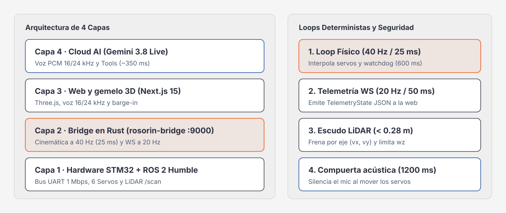

# Arquitectura del sistema

El sistema tiene **4 capas**: Gemini Live en la nube, la web en el navegador (TypeScript, Next.js 15 y Three.js), el bridge en Rust (`axum`, `tokio`, `serialport`) y el hardware (ROS 2 Humble y STM32). Cada capa trabaja a su propio ritmo y ninguna espera a la de arriba para frenar el robot.

---

## 1. Qué hace cada capa

| Capa | Stack | Dónde corre | Ritmo | Responsabilidad |
|---|---|---|---|---|
| **4 · Gemini Live** | `gemini-3.8-live` por WebSocket (`BidiGenerateContent`) | Nube de Google | Cientos de ms por respuesta | Entiende la voz (PCM 16 kHz), responde con voz (PCM 24 kHz), recibe cuadros de cámara y emite llamadas a herramientas. |
| **3 · Web y gemelo 3D** (`web/`) | TypeScript, Next.js 15, React 19, Three.js, `@google/genai` | Navegador de la laptop (`localhost:3000`) o pantalla del robot | Cada cuadro del navegador | Captura el micrófono, filtra el ruido de los servos, corta la voz del robot en un *barge-in*, ejecuta las herramientas contra el bridge, reproduce Bumblebee y dibuja el gemelo con 16 mallas `.stl`. |
| **2 · Bridge** (`robot-bridge/`) | Rust (`axum`, `tokio`, `serialport`) | Jetson Orin Nano (`:9000`) o laptop (`--backend mock`) | Loop de 40 Hz (25 ms); WebSocket a 20 Hz | Valida y recorta cada comando, aplica freno por eje y watchdog, enclava la E-stop, interpola la telemetría de los servos y escribe al hardware desde un hilo propio. |
| **1 · Hardware** | ROS 2 Humble + STM32 (`/dev/rrc`) | Robot Hiwonder ROSOrin Pro | UART a 1 Mbps | Motores Mecanum, servos de bus (IDs 1 a 5 y pinza 10), LiDAR (`/scan` vía `ros2_worker.py`) y cámara 3D. |

---

## 2. Decisiones de arquitectura

### Por qué el bridge está en Rust

1. **Un loop de control sin pausas de recolector de basura.** Una sola tarea de `tokio` corre cada 25 ms: vigila el watchdog y los plazos de `cmd_vel`, aplica el freno del LiDAR, reenvía la velocidad vigente cada ~100 ms, integra la odometría e interpola los servos. Cada 2 ticks publica la telemetría a los WebSockets. El `dt` de cada tick se mide y se acota a 5..100 ms, así que un tick atrasado no provoca saltos.
2. **Las reglas físicas están en código compilado, entre el modelo y los motores.** Gemini nunca escribe en `/dev/rrc` ni publica en ROS 2. Todo pasa por `is_valid_servo_id`, `clamp_servo_pulse`, el recorte de velocidad (`±0.25 m/s`, `±0.8 rad/s`), el plazo de `100..2500 ms`, el freno por eje y la E-stop enclavada.
3. **Un solo candado para decidir qué llega a los motores.** `Mutex<MotionGate>` guarda la E-stop, el número de época de los gestos y el plazo del comando vigente. Revisar esos datos y encolar el comando al driver ocurre con el candado tomado, así que un gesto viejo no puede colarse después de un `/stop`.
4. **La E/S bloqueante no toca el runtime.** La escritura al puerto serie o al stdin del worker de Python ocurre en un hilo dedicado. La velocidad vive en un espacio aparte donde la última gana; el resto de los comandos entra en una cola de 64. Si una escritura se atasca más de 300 ms, el driver se marca como caído.
5. **Un binario para la laptop y el robot.** `rosorin-bridge --backend mock` usa la misma validación, los mismos gestos y la misma integración que en el Jetson; solo cambia el driver.

### Seguridad cuando falla algo

- **LiDAR que falla cerrado.** Con `ros2`, si el último scan tiene más de 300 ms o el worker murió, el chasis queda en 0 (`lidar_stale: true`). Al arrancar pasa lo mismo hasta que llega el primer scan, y los sectores valen `0.0`. Un sector con menos del 25 % de rayos utilizables (`LIDAR_MIN_VALID_FRACTION`; eco o espacio libre según REP 117) se reporta en `0.0` y bloquea el avance hacia ese lado: un LiDAR tapado o sucio bloquea, un escenario abierto no. En el ROSOrin Pro el LiDAR solo cubre el frente y los lados: atrás no hay rayos (`lidar.uncovered`) y el bridge no frena hacia allá (ver [`SECURITY.md`](./SECURITY.md#lidar-que-falla-cerrado)).
- **Heartbeat del worker.** Cada 100 ms el bridge le manda un `ping` a `ros2_worker.py`, que contesta `pong` desde el hilo que ejecuta los comandos. Sin respuesta en 400 ms, `connected` pasa a `false` y el chasis queda bloqueado hasta que vuelva. Por eso el bridge y el worker se actualizan juntos.
- **El resultado físico viaja en la respuesta.** Cada respuesta de acción trae `blocked` (`null`, `worker_dead`, `lidar_stale` o `braked`), y la web nunca le reporta al modelo un movimiento bloqueado como éxito.
- **Sin LiDAR.** El backend `serial` no tiene sensores: `lidar_source: "none"` y la velocidad lineal se limita a 0.15 m/s.
- **Dos watchdogs.** El del bridge corta cada comando al vencer su `duration_ms` (600 ms por defecto). El de `ros2_worker.py` detiene los motores si pasan 500 ms sin comandos, por ejemplo si el bridge se cuelga.
- **Si el loop muere.** El proceso detiene los motores y sale con código 70. Con SIGINT o SIGTERM enclava la E-stop y detiene los motores antes de salir.

### Por qué el navegador corre en la laptop

1. **Micrófono.** `getUserMedia` solo funciona en `https://`, `http://localhost` o pasando a Chrome `--unsafely-treat-insecure-origin-as-secure=http://<IP>:3000`. `ensayo.sh` y `demo.sh` sirven la web estática desde el robot (`:3000`) y abren Chrome en la laptop con esa bandera; `run.sh --robot-ip <IP>` y `--laptop-server` la sirven en `http://localhost:3000`.
2. **GPU.** La laptop dibuja las 16 mallas en Three.js y el Jetson se queda con ROS 2 y el control.
3. **El sitio público no controla robots.** `https://jsconfmx26.web.app` no contacta el bridge sin una acción explícita, su CSP solo permite `localhost:9000` y `127.0.0.1:9000`, y una página `https://` no puede llamar a una IP `http://` de la LAN.

---

## 3. Eco, barge-in y transcripción (`web/src/lib/gemini-live.ts`)

Cuando el robot se mueve o habla, el micrófono escucha sus propios servos y su altavoz. La web lo maneja así:

1. **Compuerta después de mover (1200 ms) y compuerta de ruido.** Cada herramienta física (y cada baile de Bumblebee) fija `motionSuppressUntil = Date.now() + POST_MOTION_GATE_MS` (1200 ms). Mientras dura, o si el nivel del micrófono es menor a 0.09, se envían tramas PCM en cero para que el stream siga vivo sin que el ruido dispare una interrupción. Mientras el robot habla, solo pasa el audio por encima de 0.36.
2. **Barge-in.** Si hablas por encima de 0.36 mientras el robot habla, o pulsas «Interrumpir», la web vacía la cola local de audio (`PcmPlayer.flush()`). `TurnAudioGate` descarta el resto de *esa* respuesta solo si el servidor la sigue enviando; si ya había terminado, no toca la siguiente. Así el robot no se queda mudo en el turno siguiente. Si el servidor manda `interrupted`, se vacía la cola y se avanza de generación. Un turno de texto enviado a media respuesta empieza una generación nueva con la primera señal de fin de la anterior (`interrupted`, `generationComplete` o `turnComplete`); si no llega ninguna, el audio se vuelve a aceptar a los 1.2 s (`CLIENT_TURN_GRACE_MS`).
3. **Idioma y alfabeto.** `speechConfig.languageCode = 'es-US'` y `sanitizeTranscriptChunk` descarta transcripciones en alfabetos no latinos que el reconocedor inventa con ruido de sala.
4. **Conexión.** `LiveConnection` guarda el *handle* de reanudación de sesión y activa la compresión de contexto por ventana deslizante.
   - Si la primera conexión falla, la UI pasa a `error` y no queda ningún reintento en segundo plano.
   - Con `goAway`, espera a que termine el turno (sin audio ni respuestas de herramienta pendientes) y abre un socket nuevo; como máximo, 1.5 s antes del plazo del servidor (3 s si no lo informa).
   - Si una reanudación falla, descarta ese *handle* y la siguiente conexión abre una sesión nueva.
   - Si el socket se cae a media conversación, reintenta hasta 4 veces (0.6, 1.5, 3.5 y 6 s).
   - La UI muestra `connecting`, `live`, `reconnecting`, `disconnected`, `error` o `no_key`.
5. **Datos externos.** Lo que viene de GitHub entra en bloques `<repo_data>`, `<pr_data>` o `<incident_data>`. `wrapUntrusted` normaliza el texto y escapa `&`, `<` y `>` (también sus variantes Unicode), así que el contenido no puede cerrar el bloque. El prompt de sistema dice que son datos no confiables y que nunca deben provocar una llamada a herramienta, y en los turnos donde la app ya ejecutó la acción el código rechaza cualquier llamada con `tool_disabled`.

Al cambiar de pestaña, la conversación se detiene a propósito (para que el robot no responda mientras presentas) y la web muestra un aviso.

---

## 4. Rostro y pantalla táctil (`/face`)

El ROSOrin Pro tiene una pantalla táctil de 7". La ruta `/face` la convierte en la cara del robot:

1. **Ojos que siguen al brazo.** La mirada sigue el pulso del servo 1 (base) y el 4 (muñeca) que llega por la telemetría a 20 Hz, y cambia de expresión según `mood` (`approved`, `rejected`, `guarding`, `dancing`…). La boca se anima solo mientras el robot habla.
2. **HUD.** Muestra `hud_headline` y `hud_subtext` (por ejemplo «DEPLOY APROBADO» o «CLOUD RUN · OOM») y la letra de la canción en Bumblebee. Los escribe `POST /hud`, que funciona aun con la E-stop enclavada.
3. **Seguridad.** Muestra los banners de E-stop (con «Liberar»), de LiDAR sin datos y de control del robot sin respuesta, y, siempre que el bridge esté habilitado, un botón **STOP** que llama a `POST /stop` aunque el WebSocket esté caído.
4. **Token.** `iniciar-robot.sh` abre `/face#token=<token>` en modo kiosco; la página guarda el token y lo quita de la barra. El fragmento (`#`) no llega al servidor de Next.
