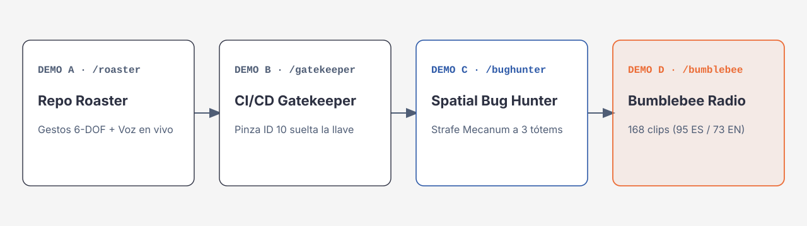

# Guía de las demos

Las 4 demos combinan un contexto (un repo, un PR, un incidente o una frase), una conversación con **Gemini Live** (audio de 16 kHz de entrada y 24 kHz de salida) y movimiento en el **Hiwonder ROSOrin Pro** o en su gemelo 3D.

Todas funcionan sin robot: si no hay bridge conectado, solo se mueve el gemelo y la herramienta le responde al modelo con `target: "simulator"`. Las conversaciones de voz necesitan tu API key de Gemini: sin ella, la zona de interacción de cada demo muestra solo la caja para ingresarla (ver [`WEB.md`](./WEB.md)).

---

## Controles comunes

- **Un clic para empezar.** El botón principal de cada demo ejecuta el movimiento, le pide al modelo que hable y deja el micrófono abierto. La app se conecta a Gemini Live antes de abrir el micrófono; si la conexión falla, el micrófono no se abre, la consola muestra «Error de conexión» y no queda ningún reintento en segundo plano: vuelve a pulsar el botón.
- **Compuerta después de mover (1200 ms).** Cada vez que el robot se mueve, el micrófono manda silencio durante 1200 ms para que el ruido de los servos no interrumpa al modelo.
- **Interrumpir.** Habla fuerte mientras el robot habla, o pulsa **Interrumpir**, y la web corta su audio. La siguiente respuesta se escucha normal.
- **Detener.** El botón **Detener** cierra el micrófono y la sesión.
- **Cambiar de ruta o de pestaña.** Al navegar con la barra superior o cambiar de pestaña, la conversación se detiene; en el segundo caso aparece un aviso.
- **Estado de la conexión.** La consola muestra Listo, Conectando…, Reconectando…, Conectado, Escuchando tu micrófono, Hablando…, Desconectado, Error de conexión o Sin API key.
- **STOP / E-stop.** Botón **STOP** de la barra superior o tecla **Escape** (también desde el panel de la píldora del robot o desde `/face`). Mientras esté enclavado, los movimientos fallan y el modelo recibe `status: "error", code: "estop_latched"` y lo dice en voz alta.
- **Movimientos bloqueados.** Si el bridge acepta un movimiento pero lo frena o lo bloquea (`blocked`: `braked`, `lidar_stale` o `worker_dead`), el modelo recibe un error con ese código y un `hint` que le pide no decir que se movió.
- **Reconocer (demos B y C).** El botón **Reconocer** hace que el robot busque dónde están de verdad las bandejas o los tótems con la cámara 3D, que va en la pinza: **solo mueve el brazo** (ninguna rueda), lo lleva a una pose que mira la mesa, gira `joint1` despacio de derecha a izquierda en 11 pausas y regresa a `home` (unos 15 s). Al lado del botón se ve «Paso i/N» y, al final, cada objeto con su ángulo, distancia y confianza. **STOP** o **Escape** lo abortan en cualquier momento. Después, los gestos apuntan a lo medido (y ya no deslizan el chasis); si no hubo reconocimiento, si el robot se movió más de 15 cm o si pasaron 15 min, usan el lado fijo de abajo. La respuesta de la herramienta le dice al modelo cuál usó. Hazlo **antes** de poner la llave en la pinza (Demo B): la tarjeta tapa parte de la cámara. Necesita el bridge (el robot o `./run.sh --mock`). En mock, la cámara simulada ve un escenario que a propósito **no** está en el lado fijo: APROBADO a la derecha, RECHAZADO a la izquierda, Gemini Live a la izquierda, Firestore casi al frente y Cloud Run a la derecha (`POST /simulate/scene` lo cambia; ver [`API.md`](./API.md#get-simulatescene-y-post-simulatescene)).

---

## Demo A · Repo Roaster (`/demos/roaster`)

- **Objetivo:** analizar un repo de GitHub y reaccionar con un gesto del brazo y el chasis (`facepalm`, `trash_toss`, `chef_kiss`, `suspicious_inspect`, `victory_spin`). `facepalm` retrocede un poco, lento y sin freno del LiDAR (atrás no tiene cobertura): deja libre detrás del robot.
- **Herramienta:** `express_verdict({ gesture, mood, verdict_headline })`.
- **Tono (system prompt propio):** la sesión de Gemini Live de esta demo usa el prompt compartido `SYSTEM_PROMPT_EN` (herramientas y datos no confiables, sin cambios) más la persona `ROASTER_PERSONA` de [`web/src/lib/prompts/roaster.ts`](../web/src/lib/prompts/roaster.ts): roast ácido y brutal en todas las respuestas, también en las preguntas de seguimiento, los mensajes escritos y las interrupciones. Una o dos frases cortas (máx. 25 palabras), español de México con términos de dev en inglés. Se burla del código y del repo, nunca de las personas. Para ajustar el tono, edita ese archivo; las demás demos no lo usan.
- **Repos preconfigurados:** `facebook/react`, `vercel/next.js`, `denoland/deno`, `ykro/rosorin-jsconf`. Estos usan datos de ensayo guardados en [`repo-analyzer.ts`](../web/src/lib/repo-analyzer.ts) (`origin: "preset_rehearsal"`), no la API de GitHub en vivo. Cualquier otro repo se consulta en `api.github.com` sin token (60 peticiones por hora por IP).
- **Si GitHub no responde:** estrellas y dependencias quedan como «no disponible» (`origin: "unavailable"`) y se le pide al modelo que lo diga en vez de inventar cifras.
- **Flujo:**
  1. Elige un repo y pulsa **Analizar y Roastear**.
  2. La app ejecuta el gesto sugerido por el análisis y le indica al modelo que no llame herramientas en ese turno: el modelo solo habla. Si aun así llama una, la app no ejecuta nada y le responde `code: "tool_disabled"`. Lo mismo pasa con los botones de las demos B y C y con los mensajes escritos o rápidos de las demos A, B y C.
  3. Sigue por voz o con los botones rápidos («Dame más detalles técnicos de lo que encontraste en el repositorio.», etc.).

---

## Demo B · Gatekeeper CI/CD (`/demos/gatekeeper`)

- **Objetivo:** el robot sostiene una llave impresa de «Production Deploy» con la pinza (servo 10 cerrado en 680). Ante un PR, gira hacia la bandeja verde de **APROBADO**, a 18 cm a la izquierda del robot (`joint1 = 700`), o la roja de **RECHAZADO**, a 18 cm a la derecha (`joint1 = 280`), y abre la pinza (220) para soltar la llave. Con el rechazo, el chasis además retrocede. Con **Reconocer**, el brazo gira hacia donde se midió cada bandeja en vez de esos lados fijos (y no se desliza). En el gemelo 3D las bandejas tienen el tamaño de las impresas (18.6 × 10.8 cm) y la llave sigue en la pinza hasta que esta se abre; entonces cae desde ahí sobre la bandeja.
- **Herramienta:** `release_deploy_key({ decision: "approve" | "reject", reason_es })`.
- **Quién decide:** la app, con una regla sobre los datos del PR (tests en verde y palabras como *test*, *canary*, *rollback* o *e2e* en la justificación). El modelo explica la decisión en voz alta.
- **Botones de preparación:**
  - **Centrar Robot:** chasis y brazo a `home`.
  - **Reconocer:** mide dónde están las bandejas verde y roja (ver Controles comunes).
  - **Sujetar Llave:** pose `gatekeeper_hold` con la pinza cerrada (680).
- **PRs de ejemplo** (escenarios simulados de una organización ficticia, `acme-cloud`; los datos están en `PRESET_PRS` de `repo-analyzer.ts`):
  1. `acme-cloud/edge-router#289`: rechazar. Saltarse la validación del middleware de pagos y borrar 42 líneas de tests para un *hotfix* de viernes, sin rollback.
  2. `acme-cloud/checkout-api#645`: aprobar. Parche de idempotencia con 18 tests E2E y canary al 5 %.
  3. `acme-cloud/rust-gateway#234`: aprobar. Límites de velocidad con la suite de tests de Rust completa en verde.

---

## Demo C · Bug Hunter (`/demos/bughunter`)

- **Objetivo:** frente al robot hay 3 tótems impresos:
  - **Cloud Run** a la izquierda (azul `#1A73E8`)
  - **Gemini Live** al centro (verde `#1E8E3E`)
  - **Firestore** a la derecha (amarillo `#F9AB00`)

  Ante un incidente, el chasis se desliza de lado (0.22 m/s durante 850 ms, unos 19 cm) y el brazo apunta al tótem culpable. Para el centro avanza unos 6 cm. Después de **Reconocer**, el chasis no se mueve: el brazo gira hacia donde se midió el tótem (azul, verde o amarillo, de pie sobre la mesa).
- **Herramienta:** `point_at_service_totem({ service: "cloud_run" | "gemini_live" | "firestore", diagnosis_es })`.
- **Quién decide:** la app, buscando palabras clave en el texto del incidente (*firestore*, *index*, *precondition* → Firestore; *audio*, *pcm*, *live*, *barge-in* → Gemini Live; el resto → Cloud Run). El modelo explica la causa.
- **Incidentes de ejemplo** (escenarios simulados de `acme-cloud`, en `repo-analyzer.ts`):
  1. `acme-cloud/cloud-run-worker#542` → **Cloud Run**: el contenedor supera los 512 MiB (`OOMKilled`) por una fuga de descriptores de WebSocket.
  2. `acme-cloud/voice-stream#142` → **Gemini Live**: la cola de audio PCM de 24 kHz pasa de 4800 ms porque no se vacía al recibir `serverContent.interrupted`.
  3. `acme-cloud/firestore-orders#798` → **Firestore**: `failed-precondition` (HTTP 400) por falta de un índice compuesto.

---

## Demo D · Bumblebee Radio (`/demos/bumblebee`)

- **Objetivo:** como Bumblebee, el robot tiene la caja de voz dañada y **solo responde con fragmentos de canciones** mientras baila con el brazo y el chasis.
- **Catálogo** ([`web/public/songs/catalog.json`](../web/public/songs/catalog.json)): 168 fragmentos con letra y metadatos emocionales, 95 en español y 73 en inglés, de 2.1 a 9.4 s.
- **MP3:** los clips no están en git; viven en `web/public/songs/clips/` de la laptop, de ahí los copian `ensayo.sh --laptop` y `demo.sh --laptop` al robot y `firebase deploy` los publica en el sitio. Si un clip no carga, la web reproduce un barrido de radio, muestra «Falta el MP3 de este clip (web/public/songs/clips): se reproduce un barrido de radio.» y mantiene la letra en el dial.
- **Bailes** (`robot-bridge/src/gestures.rs`):
  - `bumblebee_hype`: fiesta
  - `bumblebee_groove`: ritmo funk con desplazamiento lateral
  - `bumblebee_rock_out`: cabeceo rockero
  - `bumblebee_romance`: vaivén romántico
  - `bumblebee_sad_droop`: violines tristes
  - `bumblebee_sassy`: giro con actitud

  Cada clip dispara el baile y un pequeño movimiento del chasis.
- **Herramienta:** `play_radio_sequence({ clip_ids, dance_gesture, radio_caption })`. El modelo pide 1 o 2 IDs. Si ningún ID existe en el catálogo, elige el clip un buscador local. Si el servidor cancela la llamada (`toolCallCancellation`, normalmente porque lo interrumpiste) antes de que el robot empiece a bailar, la secuencia se corta y esa llamada no recibe respuesta.
- **Audio bloqueado por el navegador:** si el navegador no deja reproducir sin un toque previo, la demo muestra «El navegador bloqueó el audio: toca la página una vez y vuelve a intentarlo.», distinto del aviso de clip faltante. «Interrumpir» limpia el aviso.
- **No se escucha a sí mismo.** Las canciones suenan por las bocinas de la laptop y el micrófono de la laptop las oye. Mientras suena un clip (y 900 ms después), el micrófono le manda silencio a Gemini Live: el modelo nunca oye la canción como si fuera tu voz. El navegador pide `echoCancellation`, `noiseSuppression` y `autoGainControl`, y la consola registra cuáles aplicó (`[mic] echoCancellation=…`). Además:
  - Una transcripción que coincide con la letra que sonó (hasta 4 s después) se descarta.
  - Una llamada a `play_radio_sequence` sin que hayas dicho o escrito nada desde la última canción se ignora: es el modelo contestándose su propio clip.
- **Interrumpir (barge-in).** Habla encima de la canción: si tu voz supera claramente el eco medido durante ese clip durante unos 280 ms, la web corta la canción, abre el micrófono y le manda a Gemini tu voz, incluidos los ~340 ms previos. También puedes tocar el dial, pulsar **Interrumpir** o la tecla **Espacio** (cuando no estás escribiendo): corta la canción y abre el micrófono al instante; si la conversación no estaba abierta y hay API key, la abre.
- **Flujo:**
  1. Pulsa **📻 Iniciar Conversación Musical** (necesita API key) y háblale, o toca una frase rápida («¡Hola Bumblebee! ¿Cómo estás hoy?», «El deploy en viernes salió perfecto a la primera.», «Se cayó producción y nadie sabe por qué.») o escribe en el cuadro de texto. Con API key, cada frase es un turno de la **misma** conversación en vivo: si no estaba abierta, la abre (con micrófono, si el navegador lo permite) y sigue abierta después de la respuesta, hasta **⏹ Detener Conversación Musical**. Si Gemini no responde con `play_radio_sequence`, el buscador local elige el clip y la conversación sigue abierta. Sin micrófono (contexto no seguro o permiso denegado), la conversación sigue por texto.
  2. Sin API key la tarjeta muestra solo la caja para ingresarla: el botón, el dial, el cuadro de texto y las frases rápidas aparecen al llegar la key. Las coreografías físicas siguen disponibles.
  3. El robot sintoniza, muestra la letra en el dial y en `/face`, y baila. El historial «Secuencias Musicales Sintonizadas» guarda cada turno.

---

## Props imprimibles a escala 1:1

El PDF para imprimir en Carta o A4 al 100 % está en [`docs/rosorin-stage-props-print.pdf`](./rosorin-stage-props-print.pdf): la llave de deploy para la pinza, las 2 bandejas (aprobado y rechazado) y los 3 tótems de mesa. Se genera con [`docs/generate_props_pdf.py`](./generate_props_pdf.py), que usa Chrome o Chromium headless y copia el resultado a `web/public/props/` para la ruta `/props`.
