# Guía de onboarding y modos de ejecución



El mismo código TypeScript y el mismo binario de Rust (`rosorin-bridge`, en la carpeta `robot-bridge/`) sirven para dos modos:

1. **Simulador en tu laptop (`--mock`).** El bridge simula el chasis Mecanum, los 6 servos y el LiDAR en memoria. No necesitas robot.
2. **Laptop conectada al robot por Wi-Fi (`--robot-ip <IP>`).** La web, el gemelo 3D y el micrófono corren en tu laptop (`http://localhost:3000`) y los comandos viajan por Wi-Fi al bridge del robot (`http://<IP_DEL_ROBOT>:9000`), protegido con token.

---

## 1. Requisitos

- **Node.js 22** ([`.nvmrc`](../.nvmrc); `web/package.json` exige `>= 22.6`) y `npm`.
- **Rust con `cargo >= 1.87`**. En Linux o WSL instala antes `libudev-dev` y `pkg-config` (`sudo apt-get install -y libudev-dev pkg-config`), que pide el crate `serialport`. Si falta, `./run.sh` pregunta antes de instalarlo con rustup; en una terminal no interactiva aborta salvo con `--yes` o `ASSUME_YES=1`. Lo mismo hace con Node (vía fnm).
- **API key de Gemini** de [Google AI Studio](https://aistudio.google.com/apikey). Pégala en el navegador (botón «Ingresar API Key» de la consola de cada demo, o panel «Gemini Live API Key» en `/demo`); se guarda en `localStorage` como `rosorin_gemini_api_key`. Para desarrollo local puedes copiar [`web/.env.example`](../web/.env.example) a `web/.env.local` y llenar `NEXT_PUBLIC_GEMINI_API_KEY`, pero no hagas `npm run build` ni despliegues con ella: quedaría en el bundle público.
- **En el robot:** Ubuntu 22.04 con ROS 2 Humble y el SDK de Hiwonder (lo usa `robot-bridge/scripts/ros2_worker.py`).

---

## 2. Modo 1: todo en tu laptop

```bash
git clone https://github.com/ykro/rosorin-jsconf.git
cd rosorin-jsconf
./run.sh --mock
```

Levanta dos procesos:

- **Bridge en Rust** (`cargo run --release -- --backend mock --host 127.0.0.1 --port 9000`): `http://localhost:9000`, con telemetría por WebSocket a 20 Hz en `ws://localhost:9000/ws`. Solo escucha en loopback y, en este modo, no pide token.
- **Web Next.js 15** en `http://localhost:3000`, también solo en `127.0.0.1`.

`run.sh` imprime la URL que debes abrir. En mock es `http://localhost:3000/`.

Prueba el bridge desde la terminal:

```bash
curl http://localhost:9000/health      # {"status":"ok"}
curl http://localhost:9000/status      # telemetría completa
```

### Rutas de la web

La lista de rutas (`/demo`, `/robot`, `/face`, las 4 demos…) y cómo funcionan los gestos del simulador están en [`WEB.md`](./WEB.md).

---

## 3. Modo 2: tu laptop conectada al robot

### Paso 1: actualizar el repo en el robot

Conéctate por SSH al Jetson Orin Nano del ROSOrin Pro. El historial del repositorio se reescribió (se sacaron los MP3), así que `git pull` falla en copias viejas. Actualiza así:

```bash
cd <ruta-del-repo>
git fetch origin
git reset --hard origin/main   # descarta cambios locales sin commit
```

### Paso 2: levantar el bridge en el robot

```bash
make robot            # equivale a ./run.sh --bridge-only
```

En el robot, `run.sh`:

- Carga ROS 2 Humble (`/opt/ros/humble`, `~/ros2_ws`, `~/mission_ws`) y elige el backend `ros2` (o `serial` si no hay ROS 2 pero existe `/dev/rrc` o `/dev/ttyACM0`). Como el backend se autodetectó, pasa `--allow-mock-fallback`: si el hardware no arranca, cae a mock y lo avisa.
- Toma el token de `BRIDGE_TOKEN` o de `.bridge-token`; si no existe, genera uno con `openssl rand -hex 16` y lo guarda en `.bridge-token` con permisos `600`.
- Detiene con `sudo` `button_scan.service` y `start_app_node.service`, que ocupan `/dev/rrc`. Mientras corre el bridge, el botón físico de fábrica no actúa: usa el paro de emergencia de la web.
- No toca `wifi.service`. Si existe `~/.openclaw/workspace/ESTOP_LOCK` (el candado de paro de otra app), aborta sin borrarlo.
- Levanta `rosorin-bridge` en `0.0.0.0:9000` con el token por variable de entorno (no aparece en `ps`).

Si corres `./run.sh` en el robot sin `--bridge-only`, también levanta la web en el propio robot (`127.0.0.1:3000`, modo ligero). Para la pantalla de 7" está `./iniciar-robot.sh`, que arranca bridge y web si hace falta y abre `/face?token=<token>` en modo kiosco.

### Paso 3: traer el token a tu laptop

```bash
scp <usuario>@<IP_DEL_ROBOT>:<ruta-del-repo>/.bridge-token .bridge-token
chmod 600 .bridge-token
```

También puedes exportarlo a mano: `BRIDGE_TOKEN=<token> ./run.sh --robot-ip <IP_DEL_ROBOT>`.

Comprueba que el bridge responde:

```bash
curl http://<IP_DEL_ROBOT>:9000/health                                        # público
curl -H "x-bridge-token: $(cat .bridge-token)" http://<IP_DEL_ROBOT>:9000/status
```

### Paso 4: levantar la web en tu laptop

```bash
./run.sh --robot-ip <IP_DEL_ROBOT>
```

Sin token, el script se detiene y te dice cómo traerlo. Con token, imprime una URL como:

```text
http://localhost:3000/?token=<token>&bridge=http://<IP_DEL_ROBOT>:9000
```

Ábrela. La web guarda el token en `localStorage` (`ROSORIN_BRIDGE_TOKEN`) y la URL del bridge (`ROSORIN_BRIDGE_URL`), y quita el token de la barra de direcciones. Desde ahí lo manda como `x-bridge-token` en cada petición y como `?token=` al abrir `/ws`.

Otras formas de pasar el token o el bridge:

- Pulsa la píldora del robot en la barra superior: abre un panel con la URL del bridge, el token, «Conectar al robot» y «Paro de emergencia».
- `?bridge=http://<IP>:9000` en cualquier ruta cambia el bridge (solo acepta `localhost` o IPs de la red local); `?bridge=reset` y `?token=reset` borran lo guardado.

Nunca pongas el token en una variable `NEXT_PUBLIC_*`: se incrusta en el bundle.

> [!IMPORTANT]
> **¿Por qué `http://localhost:3000` y no la IP del robot en el navegador?** El micrófono (`getUserMedia`) solo funciona en contextos seguros: `https://` o `http://localhost`. Además, el sitio público (`https://jsconfmx26.web.app`) no sirve para el robot físico: su CSP solo permite `localhost:9000` y `127.0.0.1:9000`, y una página `https://` no puede llamar a una IP `http://` de la red local.

---

## 4. Paro de emergencia

- **Activar:** botón «Paro de emergencia» del panel del robot, botón **PARO** en `/face`, `make reset` en la máquina del bridge o `curl -X POST -H "x-bridge-token: <token>" http://<IP>:9000/stop`.
- **Efecto:** motores a 0, brazo congelado donde está (no vuelve a `home`) y E-stop enclavada. Toda ruta de movimiento responde `423 estop_latched` y la web muestra el banner «Paro de emergencia activo».
- **Liberar:** botón «Liberar» del banner, `make release` o `curl -X POST -H "x-bridge-token: <token>" http://<IP>:9000/estop/release`.

---

## 5. Banderas de `./run.sh`

`./run.sh --help` muestra la misma lista. Una bandera desconocida es un error.

| Bandera | Ejemplo | Qué hace |
|---|---|---|
| `--mock` | `./run.sh --mock` | Fuerza el backend mock. Bridge en `127.0.0.1`. |
| `--serial` | `./run.sh --serial` | Fuerza el backend serial directo al STM32 (`/dev/rrc`, 1 Mbps). No tiene LiDAR: velocidad lineal máxima 0.15 m/s. Si falla, el bridge sale con error. |
| `--ros2` | `./run.sh --ros2` | Fuerza el backend ROS 2 (`ros2_worker.py`). Si falla, el bridge sale con error. |
| `--bridge-only` | `./run.sh --bridge-only` | Solo el bridge, sin la web. Escucha en `0.0.0.0` con token. |
| `--robot-ip <IP>` / `--ip <IP>` | `./run.sh --robot-ip 10.0.0.42` | Solo la web en tu laptop, contra el bridge de `<IP>:9000`. Exige token. |
| `--port <W:B>` / `-p` | `./run.sh --port 3001:9001` | Puertos de web y bridge. Con un solo número decide por el valor (menor a 6000 es la web). |
| `--web-port <P>` | `./run.sh --web-port 3001` | Puerto de la web (3000 por defecto). |
| `--bridge-port <P>` | `./run.sh --bridge-port 9001` | Puerto del bridge (9000 por defecto). |
| `--web-lan` | `./run.sh --mock --web-lan` | Expone la web en `0.0.0.0`. Por defecto solo `127.0.0.1`. |
| `--yes` / `-y` | `./run.sh --yes` | Instala Rust o Node sin preguntar si faltan. |
| `--help` / `-h` | `./run.sh --help` | Muestra la ayuda. |

Variables de entorno que lee `run.sh`: `BRIDGE_TOKEN`, `ROBOT_BACKEND` (explícito, sin caída a mock), `ROBOT_IP`, `WEB_PORT`, `BRIDGE_PORT`, `ASSUME_YES`, `WEB_LAN`. Las del bridge están en [`robot-bridge/.env.example`](../robot-bridge/.env.example) y las de la web en [`web/.env.example`](../web/.env.example).

---

## 6. Problemas comunes

| Síntoma | Causa y solución |
|---|---|
| El bridge sale con código `2` | Escucha fuera de loopback sin `BRIDGE_TOKEN`. Define el token o usa `--host 127.0.0.1`. |
| El bridge sale con código `1` | El backend pedido (`--serial`, `--ros2` o `ROBOT_BACKEND`) no arrancó, o el nombre no existe. |
| Banner «El bridge pide token» | Falta el token o no coincide. Pégalo en el panel del robot o abre la web con `?token=`. |
| `403 forbidden_origin` o `forbidden_host` | La página o el nombre del robot no están permitidos. Agrega el origen a `BRIDGE_ALLOWED_ORIGINS` o el nombre (por ejemplo `rosorin.local`) a `BRIDGE_ALLOWED_HOSTS`. |
| Banner «LiDAR sin datos: chasis bloqueado» | Con `ros2` no llega `/scan` desde hace más de 300 ms (o el worker murió). El brazo sigue funcionando; revisa el driver del LiDAR con `ros2 topic hz /scan`. |
| El robot no avanza aunque no hay nada enfrente | Revisa la sombra del brazo: si el brazo aparece entre 0.12 m y 0.28 m frente al LiDAR, el freno se activa. Ajusta `ARM_SHADOW_MAX_M` y `ARM_SHADOW_HALF_ANGLE_DEG`. |
| Todo responde `423` | La E-stop está enclavada. Libérala con «Liberar» o `make release`. |
| `429 rate_limited` | Más de 30 POST por segundo (ráfaga de 60). `/stop` siempre pasa. |
| `git pull` falla en el robot | El historial se reescribió: `git fetch origin && git reset --hard origin/main`. |
