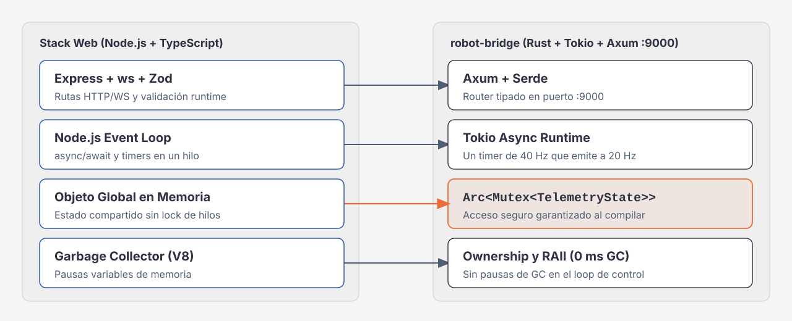
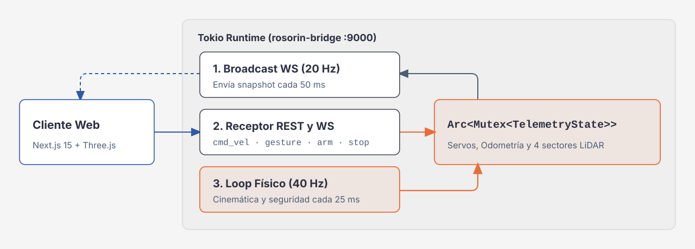
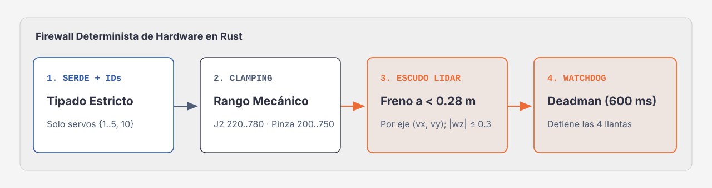

# Rust para web developers: cómo funciona `robot-bridge`



Si vienes de TypeScript y Node.js, [`robot-bridge/`](../robot-bridge/src/main.rs) se parece a un servidor Express con `ws` en el puerto 9000. La diferencia es que está compilado a código nativo y que sus reglas de seguridad no dependen de que el cliente se porte bien.

---

## 1. Equivalencias

| En Node.js / TypeScript | En `robot-bridge` | Por qué importa con un robot |
| :--- | :--- | :--- |
| Event loop (`async`/`await`) | Runtime de `tokio` (`#[tokio::main]`) | Corre el loop de control, el servidor HTTP y los WebSockets en el mismo proceso. |
| Express + `ws` | `axum` (`Router`, `WebSocketUpgrade`, `middleware::from_fn_with_state`) | Rutas tipadas y capas de seguridad (host/origen, CORS, límite de cuerpo, token, rate limit) en orden fijo. |
| Estado global (`let state = {…}`) | `Arc<RobotController>` con `Mutex<MotionGate>` y `Arc<Mutex<TelemetryState>>` | El compilador no deja compartir datos entre hilos sin un candado. |
| Zod + `JSON.parse()` | `serde` (`#[derive(Deserialize)]`) | Un tipo incorrecto se rechaza con `422` antes de llegar al handler. |
| `serialport` en Node | Crate `serialport` (1 000 000 bps) | Escribe las tramas `0xAA 0x55` con CRC8 al STM32. |
| Recolector de basura de V8 | *Ownership* y RAII | El loop de 40 Hz no tiene pausas de GC. |

---

## 2. Qué corre en paralelo



Al arrancar (`cargo run -- --backend mock`, `./run.sh --mock` o el binario en el Jetson), `main` crea un `RobotController` y lo comparte con `Arc`. Luego corren:

1. **Una tarea `tokio::spawn` para el loop de control.** Un `tokio::time::interval` de 25 ms llama a `tick(dt_s)` y, cada 2 ticks, publica la telemetría en un canal `broadcast`. El `dt` se mide de verdad y se acota, así que un tick que llega tarde no hace saltar la odometría:

   ```rust
   let dt_s = now
       .duration_since(last_tick)
       .as_secs_f32()
       .clamp(0.005, 0.100);
   last_tick = now;
   tick_robot.tick(dt_s);
   step += 1;
   if step.is_multiple_of(2) {
       let _ = tx.send(tick_robot.snapshot());
   }
   ```

2. **El servidor `axum`.** Atiende cada petición HTTP en las tareas que `axum` crea por conexión.
3. **Dos tareas por cada cliente WebSocket.** Una reenvía la telemetría del `broadcast` y los eventos `error` y `blocked`; la otra lee los comandos (`cmd_vel`, `gesture`, `arm`, `jog`, `reset_scene`, `stop`).
4. **Un hilo del sistema operativo para escribir al hardware.** Con `serial` escribe en `/dev/rrc`; con `ros2` escribe JSON en el stdin de `ros2_worker.py`. La velocidad va en un espacio donde la última gana; los demás comandos, en una cola de 64. Un error de escritura, o una escritura atascada más de 300 ms, pone `connected = false`. Con `ros2`, además, el worker debe contestar cada `ping` del *heartbeat* (uno cada 100 ms) en menos de 400 ms; si no, también `connected = false`, hasta que vuelva a contestar.
5. **La supervisión.** `main` espera con `tokio::select!` al loop, al servidor y a las señales. Si el loop termina o hace *panic*, detiene los motores y sale con código 70. Con SIGINT o SIGTERM enclava la E-stop y pone el chasis en 0 antes de salir.

### Los dos candados

- **`Mutex<MotionGate>`** decide qué llega a los motores: guarda si la E-stop está enclavada, la época del gesto activo (cada comando nuevo la incrementa y cancela el gesto anterior), el plazo del `cmd_vel` vigente y el último envío al driver. Revisar la E-stop y encolar el comando ocurren con este candado tomado, así un gesto viejo no puede mover el robot después de un `/stop`.
- **`Arc<Mutex<TelemetryState>>`** guarda lo que se reporta: servos, odometría, LiDAR, HUD y banderas. El orden de toma es siempre *gate* → *state*.

Son `std::sync::Mutex`, no `tokio::sync::Mutex`: se toman por microsegundos y nunca a través de un `.await`.

### Qué hace `tick(dt_s)`

1. **Seguridad** (`enforce_motion_safety`): con `ros2`, encola el `ping` del *heartbeat* cuando toca. Si venció el plazo del comando, pone la velocidad en 0 (sin enclavar). Si el LiDAR está sin datos o el driver no responde, la deja en 0. Si no, aplica el freno por eje. Mientras haya un comando vigente, reenvía la velocidad al driver cada ~100 ms.
2. **Integración**: suma `velocidad × dt` a la odometría (no hay encoders en la telemetría) y mueve cada servo hacia su objetivo a su velocidad en pulsos por segundo.

La velocidad de cada servo se calcula al recibir `/arm`: `|Δ| / duración`, recortada a `150..1800` pulsos por segundo.

---

## 3. Las barreras entre el modelo y los motores



Gemini Live nunca habla directo con el bus serie. Cada comando pasa por estas barreras:

1. **Tipos e IDs.** `serde` rechaza tipos incorrectos con `422`. `is_valid_servo_id` solo acepta `{1, 2, 3, 4, 5, 10}` (la pinza es el 10, no el 6) y `/arm` pide entre 1 y 6 servos; si no, `400 invalid_request`. En `/servo/jog`, un `delta` fuera de `-300..300` también es `400`.
2. **Recorte por articulación** (`clamp_servo_pulse`): las posiciones fuera de rango no son error, se recortan.
   - Servo 1 (base): `120..880`
   - Servo 2 (hombro): `220..780`, para no golpear el LiDAR
   - Servos 3 y 4 (codo y muñeca): `150..850`
   - Servo 5 (giro de muñeca): `100..900`
   - Servo 10 (pinza): `200..750` (220 abierta, 680 cerrada sobre la llave)
3. **Freno por eje del LiDAR.** Se aplica al recibir la velocidad y en cada tick. Esta es la función, tal cual está en `backend.rs`:

   ```rust
   pub fn apply_lidar_brake(l: &LidarSectors, vx: f32, vy: f32, wz: f32) -> (f32, f32, f32, bool) {
       let (mut vx, mut vy, mut wz) = (vx, vy, wz);
       let mut braked = false;
       let near = |sector: &str, m: f32| l.covers(sector) && m < LIDAR_BRAKE_M;
       if (vx > 0.0 && near("front", l.front_m)) || (vx < 0.0 && near("back", l.back_m)) {
           vx = 0.0;
           braked = true;
       }
       if (vy > 0.0 && near("left", l.left_m)) || (vy < 0.0 && near("right", l.right_m)) {
           vy = 0.0;
           braked = true;
       }
       if l.min_m() < LIDAR_BRAKE_M && wz.abs() > LIDAR_BRAKE_MAX_WZ {
           wz = wz.signum() * LIDAR_BRAKE_MAX_WZ;
           braked = true;
       }
       (vx, vy, wz, braked)
   }
   ```

   `LIDAR_BRAKE_M` es 0.28 m y `LIDAR_BRAKE_MAX_WZ` 0.3 rad/s. Con `ros2`, si el último scan tiene más de 300 ms la velocidad es 0 sin importar el sector. Los datos vienen de `/scan` vía `ros2_worker.py`, o de `/simulate/lidar` en mock. Un sector ciego llega como `0.0`, así que esta misma función lo trata como obstáculo. Un sector sin cobertura (en `uncovered`, como atrás en el ROSOrin Pro, que lo tapan el chasis y los cables) no frena: `covers()` lo excluye. El `bool` que devuelve es el que termina como `blocked: "braked"` en la respuesta HTTP.
4. **Límites de chasis y watchdog.** Las velocidades se recortan a `±0.25 m/s` y `±0.8 rad/s` (`±0.15 m/s` lineal con `serial`), y cada comando dura `100..2500 ms` (600 ms si no dices). Al vencer, el loop pone el chasis en 0.
5. **E-stop enclavada.** Después de `POST /stop`, toda ruta de movimiento responde `423` hasta `POST /estop/release`.

Cuando una barrera cambia lo que pediste sin rechazar la petición (freno, LiDAR sin datos o driver caído), la respuesta sigue siendo `200`, pero trae `blocked` con el motivo. Es como devolver `{ ok: true, result }` en vez de lanzar una excepción: el cliente decide qué decirle al usuario o al modelo.

---

## 4. Para seguir leyendo

- [`robot-bridge/src/main.rs`](../robot-bridge/src/main.rs): rutas, middlewares, WebSocket y el loop.
- [`robot-bridge/src/backend.rs`](../robot-bridge/src/backend.rs): `MotionGate`, freno, watchdog, backends y el hilo escritor.
- [`robot-bridge/src/protocol.rs`](../robot-bridge/src/protocol.rs): tramas del STM32, cinemática Mecanum y límites.
- [`docs/API.md`](./API.md): el contrato completo.
- Corre `make test` para ver los tests de cada barrera.
